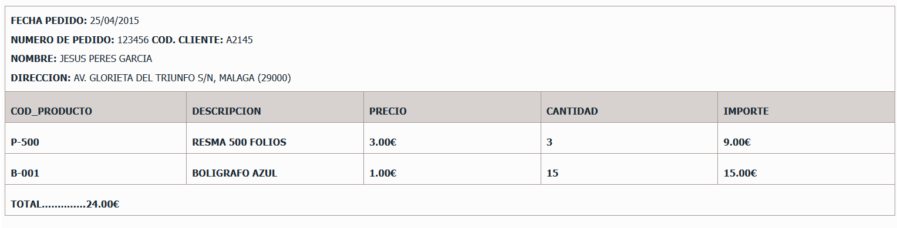
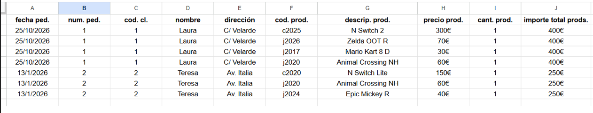
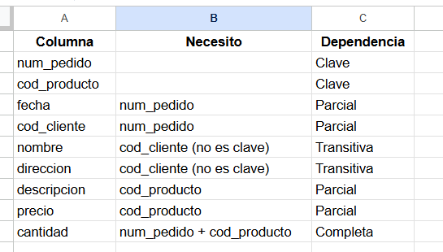

# IFCD0112-MF0226-SQL-BBDD-Relacionales-ejer-2
## Enunciado:
En un comercio se desea tener los siguientes datos de un pedido almacenados:

Aplica las FN para eliminar redundancia de datos y optimizar y obtener el mejor rendimiento de la BD. Determina las tablas necesarias con sus claves e índices, indicando el tipo de dato y los valores que puede tomar. Si hay desnormalización, justifícala.
Objetivos:
- Comprender y aplicar los fundamentos conceptuales y las técnicas de las bases de datos relacionales.
- Explicar los objetivos de la teoría de la normalización y describir las diferentes formas normales: 1FN, 2FN, 3FN, 4FN y 5FN.
- Explicar las razones por las que se procede a la desnormalización de los modelos de datos.

## Desarrollo:
### 1. Detectar el problema
He hecho una tabla caótica a posta:

Para ver cómo sería pasar la factura con todos sus apartados a una versión tabla. Problema detectado: cada producto del pedido ocupa una fila, y los datos del pedido y del cliente se repiten en todas ellas. Esto provoca anomalías: si el cliente cambia de dirección, hay que modificarla en varias filas; si se borra un pedido, se pierden los datos del cliente; y no se puede dar de alta un producto que nadie ha comprado todavía.

### 2. La solución:
En la teoría de la normalización el objetivo es evitar que se repitan filas, si detecto que se repiten filas ya es motivo para desplazar esas columnas a otra tabla.

### 3. Detectar los tipos de dependencia funcional:
Según la teoría, para encontrar las columnas problemáticas (parciales) hay que realizar a cada columna que no es clave la siguiente pregunta: "para obtener tu valor ¿qué necesito saber?"
- Si la respuesta son todas las clave key = COMPLETA (todo bien).
- Si la respuesta es alguna pero no todas = PARCIAL (problema).
- Si la respuesta es que no es ninguna clave key = TRANSITIVA (problema también).

También vale mirar la tabla y ver que si se repiten las filas hay que sacarlas y jugar con las claves forágenas, pero aplicarlo es más profesional y certero:
- Primero identifiqué las keys de la tabla caótica: son num_pedido y cod_producto, lo averigué haciendo el truco de la repetición-pareja (yo lo he llamado así), primero miro columna a columna si hay repeticiones, la que no repita valores es la key, pero si todas se repiten, pruebo parejas, la primera pareja que no repita, es la key compuesta (eso se puede hacer fácilmente con IA si tienes cientos de filas).
- Segundo: empecé a comparar las dependencias unas con otras realizando la pregunta que planteé antes y así saqué una a una cuál es completa, parcial y transitiva. Para ver cómo quedó: 
Tras esto, decidí que repartir la información en cuatro tablas sería lo más óptimo.

### 4. Tablas:
[Ver código SQL](tablas-sql.sql)

### 5. Mis métodos para crear las tablas:
El objetivo no es evitar que no se repitan valores, es que no se repita información.
Si borro 1 fila repetida puede ocurrir que no pase nada, entonces sobra y hay que hacer algo; pero si al quitarla se produce un error (pérdida de información) = la tabla es óptima.
¿Cada columna que no es clave necesita a las que son clave? si sí = correcto, si no = PARCIAL / TRANSITIVAS. Como cantidad que necesita a num_pedido y cod_producto para funcionar.

### 6. Las desnormalizaciones:
Parece que podemos romper las reglas si está bien justificado, yo opino estas 3 pero son opcionales, y opino que deberían estar porque es información que consultarla puede ser interesante, por eso quizás vale la pena guardarla en la DB:
- Dejar importe_total en la tabla de pedidos: hace un cálculo de sumar todo.
- Añadir la columna uds_vendidas en la tabla de productos: también es una suma.
- Dejar precio_unidad en la tabla 4: un cliente pagó un producto pero administración tardó en hacerle la factura, en ese tiempo que tardó, el precio del producto subió (cambió), para cuando administración saque la factura, se genera con un precio moderno, cuando el cliente pagó el precio antiguo. El código para generar la factura usa precio_unidad de la tabla 4 en vez precio de la tabla 2 (productos). precio_unidad es lo que se pagó por ese producto en ese entonces para ese número de pedido (num_pedido), precio (tabla productos) es el precio estándar y actual cambiante.

### 7. Finalmente, los FN:
- 1FN: 1 celda = 1 valor. Afortunadamente no me he inventado que la tabla caótica tuviera varios valores en una sola celda, de ser así, este FN se encarga en transformar eso en lo que sería la tabla caótica que propuse: varias filas redundantes.
- 2FN y 3FN: curar la dependencia funcional PARCIAL y TRANSITIVA. La solución de las 4 tablas y sus foraign keys.
